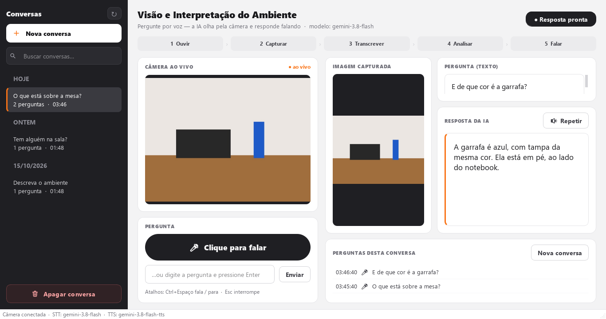

# Projeto 1 — Visão e Interpretação do Ambiente com LLM

Aplicação em Python que **ouve uma pergunta pelo microfone, tira uma foto pela webcam no
momento da pergunta, envia imagem + pergunta para um modelo multimodal (**Gemini** ou **OpenAI**) e responde
em voz alta**, mostrando na tela a imagem usada, a pergunta e a resposta.



> Exemplo — Usuário: *"O que está sobre a mesa?"* → Robô: *"Vejo um notebook e uma garrafa sobre a mesa."*

---

## 1. Requisitos

| Item | Versão / observação |
|---|---|
| Python | 3.10 ou superior |
| Webcam e microfone | qualquer dispositivo reconhecido pelo sistema |
| Chave de API | **Gemini** (camada gratuita) — <https://aistudio.google.com/apikey> ou **OpenAI** (exige créditos) — <https://platform.openai.com/api-keys> |
| Linux apenas | `sudo apt install libportaudio2 espeak-ng` (áudio e voz offline) |

## 2. Instalação

```bash
# 1. Entre na pasta do projeto
cd projeto_visao_llm

# 2. Crie e ative um ambiente virtual
python -m venv .venv
# Windows:
.venv\Scripts\activate
# Linux/macOS:
source .venv/bin/activate

# 3. Instale as dependências
pip install -r requirements.txt

# 4. Configure a chave (RNF01 — nunca no código)
#    Windows: copy .env.example .env      Linux/macOS: cp .env.example .env
#    Abra o .env, escolha PROVEDOR=gemini (ou openai) e cole a chave correspondente.
```

## 3. Execução

```bash
python main.py                    # abre a interface
python main.py --diagnostico      # testa chave, câmera, microfone, alto-falante e conexão
python main.py --camera 1         # usa a segunda webcam
python main.py --camera foto.jpg  # usa uma imagem/vídeo no lugar da webcam (demonstração)
python main.py --sem-voz          # só texto, sem falar a resposta
python main.py --provedor openai  # troca de provedor sem editar o .env
```

**Como usar:** clique em **🎤 Clique para falar** (ou `Ctrl+Espaço`), faça a pergunta e fique em
silêncio — a gravação para sozinha. Também é possível clicar em **■ Parar e enviar**, ou digitar a
pergunta na caixa de texto. Durante a fala, o botão vira **■ Interromper fala** (`Esc`).

**Textos longos:** perguntas e respostas grandes ganham barra de rolagem na própria caixa, então dá
para ler tudo até o fim. A janela abre num tamanho que cabe na sua tela (sem ficar atrás da barra de
tarefas do Windows).

**Conversas (barra lateral):** cada conversa é salva automaticamente, e a barra à esquerda lista
todas, agrupadas por dia e com busca.

- **＋ Nova conversa** (ou `Ctrl+N`) começa um chat novo e zera o contexto; as anteriores continuam salvas.
- Clique em uma conversa para reabri-la com as perguntas, fotos e respostas; novas perguntas **continuam
  nela**, e o modelo recebe as últimas trocas como contexto.
- **↻** relê o que está salvo em disco (traz conversas novas, inclusive de outra janela do app).
- **🗑 Apagar conversa** (ou botão direito na conversa) remove os registros e as fotos, com confirmação.

Tudo fica em `registros/` (`interacoes.jsonl` + fotos em `registros/AAAA-MM-DD/`). Para desligar a
gravação, use `SALVAR_HISTORICO=false`.

A barra de etapas mostra em tempo real: **Ouvir → Capturar → Transcrever → Analisar → Falar** (RF05).

## 4. Testes

```bash
pytest
```

127 testes automatizados, **sem usar rede, câmera ou microfone reais** (dublês e transporte HTTP
simulado). Incluem falha de conexão, timeout, erros HTTP da API, câmera indisponível, microfone
ausente, falha de voz e responsividade da interface. Detalhes em
[`docs/REGISTRO_DE_TESTES.md`](docs/REGISTRO_DE_TESTES.md).

## 5. Estrutura

```
projeto_visao_llm/
├── main.py                    # atalho: python main.py
├── requirements.txt
├── .env.example               # modelo de configuração (copie para .env)
├── visao_llm/
│   ├── __main__.py            # argumentos de linha de comando
│   ├── config.py              # leitura do .env / variáveis de ambiente (RNF01)
│   ├── errors.py              # erros com mensagens amigáveis (RNF02)
│   ├── camera.py              # webcam via OpenCV, redimensiona e gera JPEG (RF01)
│   ├── audio.py               # microfone com detecção de silêncio; reprodução (RF02/RF04)
│   ├── openai_service.py      # STT, modelo de visão e TTS da OpenAI + tradução de erros (RF02–RF04)
│   ├── gemini_service.py      # STT e TTS do Gemini (a visão reaproveita o openai_service)
│   ├── speaker.py             # fala a resposta; cai para voz offline se a API falhar
│   ├── pipeline.py            # orquestra o fluxo completo, independente da interface
│   ├── history.py             # salva, agrupa em conversas, relê e apaga registros em registros/
│   ├── factory.py             # monta os serviços reais a partir da configuração
│   ├── diagnostics.py         # python main.py --diagnostico
│   └── gui/                   # PyQt5: janela, threads de trabalho, estilo (RF05/RNF03)
├── tests/                     # pytest
└── docs/
    ├── ARQUITETURA.md         # arquitetura, requisitos e fluxo de dados
    └── REGISTRO_DE_TESTES.md  # testes automatizados + roteiro de demonstração
```

## 6. Configuração (`.env`)

| Variável | Padrão | Descrição |
|---|---|---|
| `PROVEDOR` | `openai` | `gemini` ou `openai` (também por `--provedor`) |
| `GEMINI_API_KEY` / `OPENAI_API_KEY` | — | chave do provedor escolhido (**obrigatória**) |
| `MODELO_VISAO` | `gemini-3.8-flash` · `gpt-4.1-mini` | modelo multimodal (aceita imagem) |
| `MODELO_STT` | `gemini-3.8-flash` · `gpt-4o-mini-transcribe` | transcrição da fala |
| `MODELO_TTS` / `VOZ_TTS` | `gemini-3.8-flash-tts` / `Kore` · `gpt-4o-mini-tts` / `alloy` | síntese de voz |
| `CAMERA` | `0` | índice da webcam ou caminho de vídeo/imagem |
| `SILENCIO_SEG` | `1.3` | segundos de silêncio que encerram a gravação |
| `GRAVACAO_MAX_SEG` | `15` | duração máxima da pergunta |
| `TIMEOUT_REQUISICAO` / `TENTATIVAS_API` | `30` / `2` | rede |
| `TTS_OFFLINE_FALLBACK` | `true` | usa voz local (pyttsx3) se a TTS online falhar |
| `SALVAR_HISTORICO` | `true` | grava as interações em `registros/` |

Os nomes de modelos mudam com o tempo: se o diagnóstico disser que um modelo não está
disponível para sua conta, troque-o no `.env` por um modelo atual com suporte a imagem.

## 7. Trocando de provedor (Gemini ⇄ OpenAI)

O projeto funciona com os dois. Para alternar, basta mudar `PROVEDOR` no `.env` e ter a chave do
provedor escolhido preenchida — não há mudança de código. Cada provedor usa seus próprios modelos
padrão; se você sobrescrever `MODELO_*`, lembre de ajustar ao trocar.

## 8. Solução de problemas

| Sintoma | O que fazer |
|---|---|
| "Câmera indisponível" | Feche outros apps que usam a webcam (Teams, Zoom, navegador); tente `--camera 1`. O app reconecta sozinho a cada 3 s. |
| "Biblioteca de áudio indisponível" | Linux: `sudo apt install libportaudio2`. Enquanto isso, digite a pergunta. |
| "Não ouvi nenhuma pergunta" | Fale mais perto do microfone; confira o microfone padrão do sistema. |
| "Chave da API inválida" | Confira `GEMINI_API_KEY`/`OPENAI_API_KEY` (a que corresponde ao `PROVEDOR`) e reinicie. |
| "Limite de uso da API" | Sem créditos ou muitas requisições — aguarde ou recarregue créditos. |
| Resposta aparece mas não é falada | Aviso amarelo explica o motivo; a resposta em texto continua válida. |

Logs completos ficam em `logs/app.log`.

## 9. Limitações conhecidas

- **Gravação do histórico acontece no fim do fluxo.** A conversa só é salva depois que a resposta
  é exibida **e** a voz termina (ou falha). Fechar o app normalmente durante a *reprodução* da voz
  ainda salva, pois a fala é interrompida e o fluxo conclui. Mas se o app for fechado durante a
  *geração* da voz (uma chamada de rede que leva alguns segundos), ou travar ou for encerrado à
  força antes do fim, **aquela pergunta não fica salva** (a resposta aparece na tela, mas não no
  histórico). As perguntas anteriores não são afetadas.
- Com `SALVAR_HISTORICO=false` nada é gravado e a barra lateral mostra um aviso.

Detalhes e a correção planejada: [`docs/README_DESENVOLVIMENTO.md`](docs/README_DESENVOLVIMENTO.md#limitações-conhecidas).

## 10. Documentação do desenvolvimento

O que foi feito, o estado atual, o que falta e como contribuir: [`docs/README_DESENVOLVIMENTO.md`](docs/README_DESENVOLVIMENTO.md).
