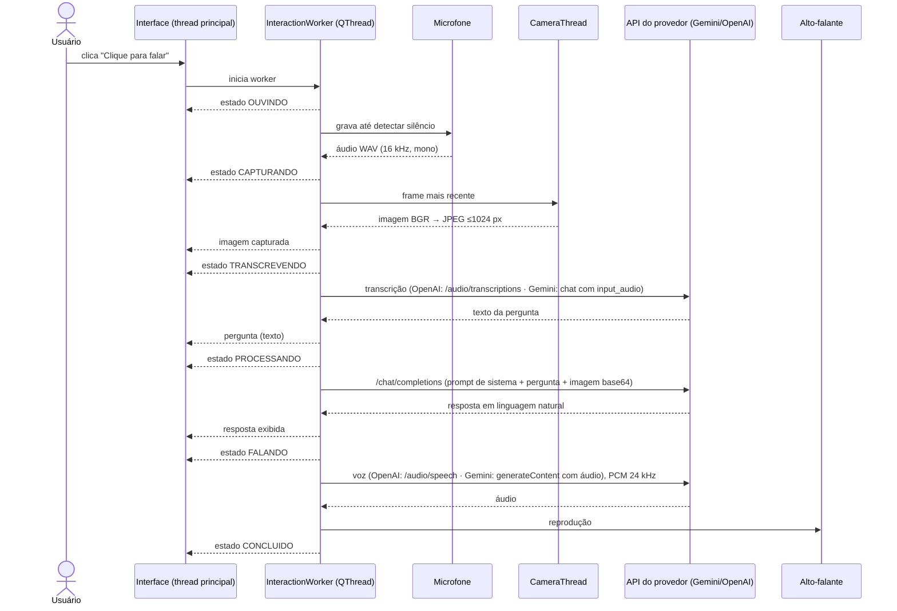

# Documento de Arquitetura — Visão e Interpretação do Ambiente com LLM

**Disciplina:** Engenharia de Software · **Projeto:** 1 (prático em grupo)

## 1. Visão geral

O sistema permite que o usuário faça perguntas por voz sobre o ambiente à frente da webcam. A
cada pergunta, uma foto é capturada no momento em que o usuário termina de falar; a pergunta é
transcrita (STT), enviada junto com a imagem a um modelo multimodal (Gemini ou OpenAI, conforme `PROVEDOR`), e a resposta é
exibida na tela e falada no alto-falante (TTS).

```
Webcam + Microfone → Captura e STT → API (modelo multimodal) → Resposta textual → TTS + Alto-falante
                                                                     ↓
                                                         Interface (imagem, pergunta, resposta)
```

## 2. Requisitos e onde são atendidos

| ID | Requisito | Implementação | Testes |
|---|---|---|---|
| RF01 | Capturar imagens por webcam | `camera.py` (`Camera`, `encode_jpeg`); `gui/workers.py` (`CameraThread`) | CT03–CT05 |
| RF02 | Reconhecer perguntas pelo microfone | `audio.py` (`AudioRecorder`, `SilenceDetector`); `openai_service.SpeechToText` / `gemini_service.GeminiSpeechToText` | CT06–CT08, CT13 |
| RF03 | Enviar imagem e pergunta a um modelo multimodal | `openai_service.VisionAssistant` (Chat Completions com imagem em base64) | CT09 |
| RF04 | Exibir resposta textual e reproduzi-la em áudio | `openai_service.TextToSpeech` / `gemini_service.GeminiTextToSpeech`, `speaker.py`, `gui/main_window.py` | CT14, CT19–CT21 |
| RF05 | Interface com estados de captura, processamento e resposta | `models.State`, `gui/widgets.StepIndicator`, indicador de status | CT15, CT21, CT25 |
| RNF01 | Chave da API fora do código-fonte | `config.py` lê `GEMINI_API_KEY` ou `OPENAI_API_KEY` (conforme `PROVEDOR`) do ambiente/`.env` (ignorado pelo git); a chave não aparece em `repr`/logs nem na página Ajustes | CT01, CT02 + varredura do código |
| RNF02 | Tratar falhas de câmera, microfone, conexão e API sem encerrar | `errors.py` (hierarquia com mensagens amigáveis); `openai_service.api_errors`; reconexão automática da câmera; `sys.excepthook` na GUI; página Diagnóstico com dicas | CT03, CT06–CT08, CT10–CT12, CT17–CT20, CT22–CT24 |
| RNF03 | Interface responsiva durante chamadas de rede | Todo o fluxo roda em `QThread` (`InteractionWorker`); comunicação com a GUI por sinais Qt | CT25 |

## 3. Arquitetura em camadas

```
┌── Apresentação (PyQt5) ────────────────────────────────────────────────────────────────────┐
│ MainWindow · NavRail · ConversationSidebar · páginas Diagnóstico, Ajustes e Ajuda          │
│ StepIndicator · ImageView · CameraThread · InteractionWorker · DiagnosticsWorker           │
└──────────────────────────────────────────────┬─────────────────────────────────────────────┘
                                               │ callbacks (estado, foto, pergunta, resposta)
┌── Aplicação ─────────────────────────────────┴─────────────────────────────────────────────┐
│ pipeline.Assistant: orquestra o fluxo e as conversas; não conhece o Qt nem o provedor      │
└──┬──────────────────┬──────────────────┬──────────────────┬──────────────────┬─────────────┘
   │ FrameProvider    │ Recorder         │ Transcriber      │ Vision           │ Voice / Store
┌──▼─────────────┐ ┌──▼─────────────┐ ┌──▼─────────────┐ ┌──▼─────────────┐ ┌──▼─────────────┐
│   camera.py    │ │    audio.py    │ │  SpeechToText  │ │VisionAssistant │ │speaker/history │
│    (OpenCV)    │ │ (sounddevice)  │ │(Gemini/OpenAI) │ │(Gemini/OpenAI) │ │(voz, registros)│
└────────────────┘ └────────────────┘ └────────────────┘ └────────────────┘ └────────────────┘
     Infraestrutura: config.py · env_file.py · errors.py · logging_setup.py · factory.py
```

**Decisões de projeto**

- **Inversão de dependência:** o `Assistant` recebe seus componentes por meio de interfaces
  (`Protocol`). Isso permite testar todo o fluxo sem câmera, microfone ou internet, e trocar o
  provedor sem mexer na interface: `factory.py` escolhe as implementações de STT, visão e TTS
  de acordo com `PROVEDOR` (OpenAI ou Gemini).
- **Gemini pelo SDK da OpenAI:** o Gemini oferece um endpoint compatível, então a visão reutiliza
  `VisionAssistant` e a transcrição usa `input_audio` em uma chamada de chat. Esse endpoint não
  tem TTS, que usa a API nativa `generateContent` (`gemini_service.GeminiTextToSpeech`).
- **Erros como parte do domínio:** toda falha conhecida vira uma subclasse de `AppError` com
  mensagem em português pronta para exibição. Exceções do SDK (OpenAI/Gemini) são traduzidas em um
  único ponto (`api_errors`).
- **Modo conversa no pipeline:** `Assistant.converse()` repete o fluxo de voz sem novo clique.
  O gravador espera a fala sem limite (`aguardar_fala=True`) e envia só a partir de meio segundo
  antes dela; depois da transcrição, `pedido_de_encerramento()` reconhece frases curtas como
  "encerrar conversa". Silêncio volta a ouvir, erros de uma rodada são avisados e a conversa
  segue, e só falta de microfone ou de chave a interrompe. A interface roda o laço em um
  `ConversationWorker` (QThread).
- **Modelos rápidos por padrão:** para a conversa fluir, os padrões do Gemini são os modelos
  que responderam em cerca de 1 a 2 s por etapa nas medições com a API real.
- **Câmera opcional:** o `FrameProvider` devolve `None` quando a câmera foi desligada no app; o
  `Assistant` segue sem foto, o `VisionAssistant` envia só o texto (com o aviso de que não há
  imagem) e o registro é salvo sem arquivo de foto.
- **Imagem no momento da pergunta:** a foto é tirada logo após o fim da fala e antes da
  transcrição — reflete a cena no instante da pergunta e evita gastar chamadas pagas se a câmera
  estiver indisponível.
- **Custo e latência:** a imagem é reduzida para no máximo 1024 px no maior lado e enviada como
  JPEG; a resposta é limitada a frases curtas (vai ser falada).
- **Contexto de conversa:** as três últimas trocas (somente texto) acompanham a nova pergunta,
  permitindo perguntas de seguimento ("e de que cor ela é?").
- **Conversas persistentes:** cada interação grava o `id` da conversa (`Assistant.session_id`) em
  `registros/interacoes.jsonl`. `HistoryStore.conversations()` agrupa por conversa (registros antigos,
  sem id, viram uma conversa por dia) e `delete_conversation()` reescreve o arquivo de forma atômica.
  `gui/sidebar.py` só emite sinais; `MainWindow` carrega, apaga (com confirmação) e retoma a conversa
  com `Assistant.load_session()`, que restaura as últimas trocas como contexto do modelo.
- **Componentes de interface que só emitem sinais:** a barra de navegação, a barra de conversas
  e as páginas não conhecem umas às outras; a `MainWindow` decide o que fazer. Cada parte pode ser
  testada isoladamente.
- **Ajustes aplicados em tempo de execução:** a página Ajustes monta uma nova `Config`, a
  `MainWindow` a aplica (o `Assistant` é recriado na próxima pergunta e a câmera é reiniciada se
  mudar) e `env_file.update_env` grava só as chaves alteradas no `.env`, de forma atômica.
- **Diagnóstico único:** `diagnostics.py` separa a coleta dos resultados da forma de mostrá-los;
  o terminal (`--diagnostico`) e a página Diagnóstico usam as mesmas verificações.
- **Tema centralizado:** todas as cores ficam em constantes em `gui/style.py`; os demais arquivos da
  interface não têm cor fixa (verificado por teste).
- **Degradação graciosa:** se a voz online falhar, usa-se voz offline; se nenhuma voz funcionar,
  a resposta continua na tela com um aviso. Se o microfone faltar, o usuário pode digitar.

## 4. Fluxo de dados (pergunta por voz)



Em qualquer etapa, uma falha gera o estado **ERRO** com a mensagem correspondente no banner
vermelho; os controles voltam a ficar disponíveis para uma nova tentativa.

## 5. Dados trafegados

| Etapa | Dado | Formato |
|---|---|---|
| Microfone → STT | fala do usuário | WAV PCM 16-bit, 16 kHz, mono |
| Câmera → modelo | imagem da cena | JPEG (qualidade 85, ≤1024 px), base64 em *data URL* |
| Modelo → interface | resposta | texto em português, até 3 frases |
| TTS → alto-falante | resposta falada | PCM 16-bit, 24 kHz, mono |
| Registro local | evidência | `registros/AAAA-MM-DD/*.jpg` + `registros/interacoes.jsonl` |

## 6. Estados da interface (RF05)

`Pronto → Ouvindo… → Capturando imagem… → Transcrevendo fala… → Analisando a imagem… →
Falando resposta… → Resposta pronta`, ou `Erro` a partir de qualquer etapa. Na pergunta digitada,
as etapas Ouvir e Transcrever aparecem como puladas.

## 7. Organização da interface

A janela tem uma barra de navegação e páginas empilhadas (`QStackedWidget`):

| Página | Classe | Papel |
|---|---|---|
| Assistente | conteúdo da `MainWindow` + `ConversationSidebar` | Perguntas, foto, resposta e conversas |
| Diagnóstico | `DiagnosticsPage` | Verificações em segundo plano, com dicas |
| Ajustes | `SettingsPage` | Configuração salva no `.env` e aplicada sem reiniciar |
| Ajuda | `HelpPage` | Como usar, atalhos e informações |

Detalhes de uso em [README_INTERFACE.md](README_INTERFACE.md) e
[README_CONVERSAS.md](README_CONVERSAS.md).
